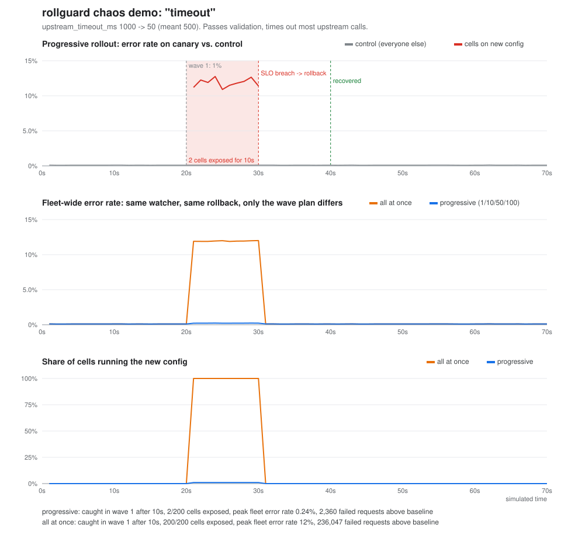
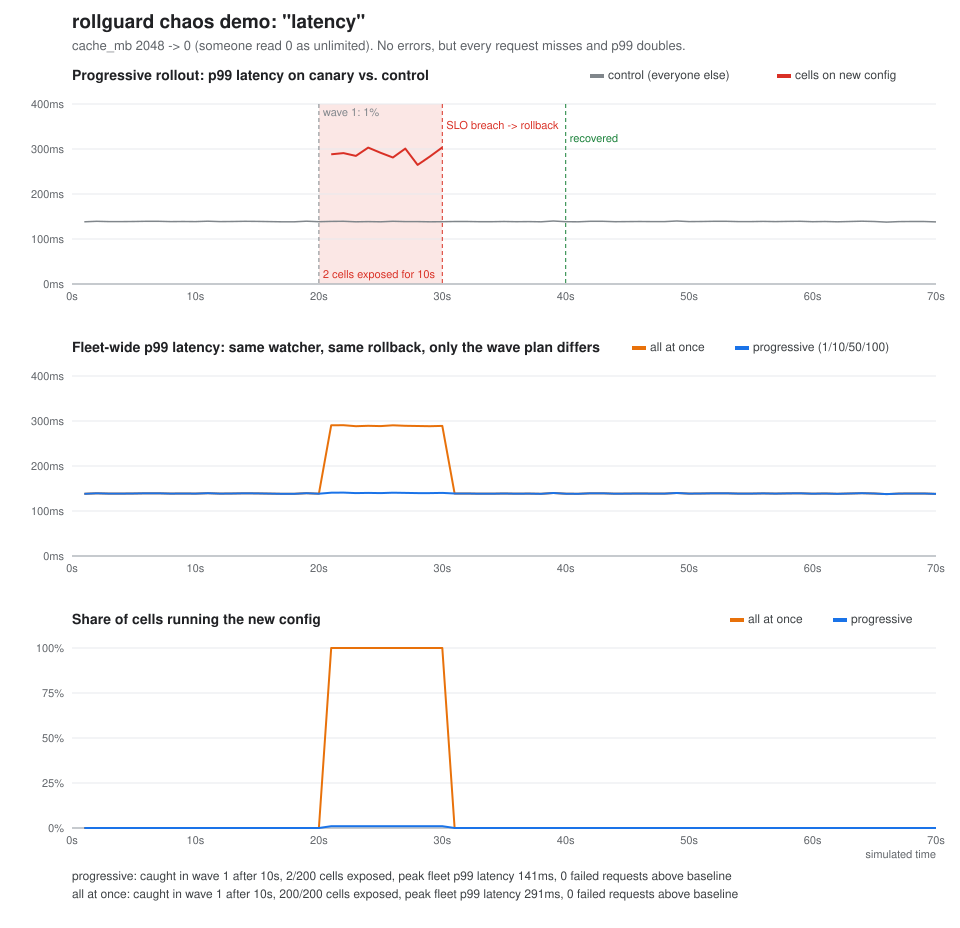

# rollguard

Progressive config rollout with SLO-based auto-rollback, in Go.

Bad config pushes keep showing up as the root cause in outage postmortems. Usually the change passed every static check: it was valid, just wrong for production. The only thing that reliably catches that is real traffic, so the goal is to let real traffic find the problem while as few users as possible are behind it.

rollguard pushes a config to cells in waves (1% → 10% → 50% → 100%), compares the cells on the new config against everyone else between waves, and rolls everything back as soon as a wave looks worse.



Above, `upstream_timeout_ms` goes from 1000 to 50 (someone meant 500). It passes validation. At the 1% wave, 2 of 200 cells start failing about 12% of requests. The watcher trips 10s later, both cells go back to the old config, and they look healthy again 10s after that. Fleet-wide error rate peaks at **0.24%** and about **2.4k** requests fail above baseline.

The same change with the same watcher and rollback, pushed to every cell at once: fleet error rate peaks at **12%** and about **236k** requests fail. The only difference is the wave plan.

## How it works

```
             validate         push wave          bake + watch           next wave
config ──▶  (schema)  ──▶  (1% of cells) ──▶  canary vs control  ──▶  10% ... 100%
                                                    │
                                              gate trips
                                                    ▼
                                    revert every updated cell at once
                                                    ▼
                                         watch until healthy again
```

- **Plan.** Cells are ordered by `hash(change id, cell)`, so each change gets its own canary set (one flaky cell doesn't keep getting blamed) but replanning the same change gives the same result. Every wave gets at least one cell, so 1% of a small fleet is still a real canary.
- **Watch.** Every interval (default 5s) the engine samples error rate and p99 for the updated cells (canary) and the rest (control). A sample is bad only if it breaks the absolute SLO *and* is meaningfully worse than control (2x errors, 1.5x latency). The relative check means a fleet-wide upstream outage won't roll back an unrelated change. On the final wave there's no control left, so only the absolute SLO applies.
- **Gate.** One noisy sample shouldn't roll anything back. The gate trips on 2 bad samples out of the last 4.
- **Rollback.** Revert every updated cell to the exact config it had before (per-cell snapshots, so mixed fleets work), all at once with no waves on the way back. Rollback ignores cancellation of the caller's context. Then it watches the reverted cells until they match control again, or flags them as not recovered.
- **Apply failures and cancellation** roll back too. A rollout either finishes or leaves the fleet where it started.

Every step goes into an event log (`-events out.jsonl`), which is the audit trail.

## Try it

```bash
go run ./cmd/rollguard demo -scenario timeout
```

```
== scenario timeout: upstream_timeout_ms 1000 -> 50 (meant 500). Passes validation, times out most upstream calls.
   ~ upstream_timeout_ms: 1000 -> 50
  t+ 20s         PLAN version b97c618558b9, 4 waves
  t+ 20s  w1     push 1% (+2 cells) us-central1-c049,us-central1-c041
  t+ 25s  w1     canary err  11.80% p99 108ms | control err  0.11% p99 139ms  BAD [...]
  t+ 30s  w1     canary err  11.88% p99 107ms | control err  0.11% p99 139ms  BAD [...]
  t+ 30s  w1     BREACH 2/4 bad samples: error rate 11.88% (slo 1.00%, control 0.11%)
  t+ 30s         ROLLBACK reverting us-central1-c049,us-central1-c041
  t+ 35s         canary err   0.10% p99 136ms | control err  0.11% p99 139ms  post-rollback ok
  t+ 40s         canary err   0.08% p99 134ms | control err  0.11% p99 139ms  post-rollback ok
  t+ 40s         RECOVERED

  progressive  rolled_back exposed   2/200 cells, caught in wave 1 after 10s, peak fleet err 0.24%, 2360 failed requests above baseline
  all at once  rolled_back exposed 200/200 cells, caught in wave 1 after 10s, peak fleet err 12.01%, 236047 failed requests above baseline
```

Scenarios:

| scenario  | change | what breaks | result |
|-----------|--------|-------------|--------|
| `timeout` | `upstream_timeout_ms` 1000 → 50 | ~12% errors | caught at 1%, 2 cells |
| `latency` | `cache_mb` 2048 → 0 | p99 139ms → 290ms, no errors | caught at 1%, 2 cells |
| `safe`    | `log_level` info → warn | nothing | goes to 100% |

The `latency` one matters because nothing errors. Error rate alone would have let it reach 100%.



Other commands:

```bash
go run ./cmd/rollguard plan                                   # show which cells land in which wave
go run ./cmd/rollguard check -config examples/invalid.json    # static validation only
go run ./cmd/rollguard push  -config examples/bad-timeout.json -events out.jsonl
make graphs                                                   # regenerate docs/*.svg
```

`push` exits 3 when the rollout gets rolled back, so it can gate a pipeline.

## The simulator

`internal/sim` is 200 cells across 4 regions at 1k rps each, and each cell's behaviour comes from its config through a small model of a service calling an upstream:

- upstream latency is lognormal (median ~40ms, p99 ~130ms)
- an attempt fails if the upstream is slower than `upstream_timeout_ms`; a request fails if all `1 + retries` attempts fail
- cache hit ratio is `1 - e^(-cache_mb/512)`, and misses load the upstream, which pushes tail latency up

So a bad value causes damage because of what it does, not because a scenario flag says "fail now". Samples carry binomial noise on errors and jitter on p99. `TestNoFalseRollbacks` runs a harmless change across 25 seeds to make sure the gate doesn't trip on noise.

The engine only depends on two interfaces, so pointing it at something real means implementing these:

```go
type Fleet interface {
    Cells() []string
    Current(cell string) (config.Config, error)
    Apply(ctx context.Context, cell string, cfg config.Config) error
}

type Signals interface {
    Sample(cells []string, window time.Duration) slo.Sample
}
```

## Layout

```
cmd/rollguard      CLI: demo, push, plan, check
internal/config    config docs, content-hash versions, diff, schema validation
internal/slo       canary vs control comparison, k-of-n gate
internal/rollout   wave planner and the rollout/rollback engine
internal/sim       fake clock and simulated fleet
internal/demo      chaos scenarios, progressive vs all-at-once runs, graphs
internal/chart     dependency-free SVG line charts
```

No dependencies outside the standard library.

## Things I'd add next

- Per-region waves (finish a region before starting the next) on top of the percentage waves
- Burn-rate alerting against an error budget instead of a fixed threshold
- Automatic pause instead of rollback when the signal is ambiguous
- A Prometheus `Signals` implementation
